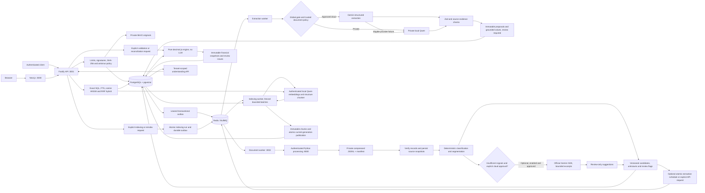

# Document intelligence architecture

The modular monolith has independently executable API/worker/web applications and a separate local Python processing service. PostgreSQL owns durable state; Redis transports compact jobs. Existing Python Work (.venv) is reused without creating a host environment. Docker runs infrastructure only.

The Python service emits normalized page/row evidence. The worker consumes verified records once for bounded PostgreSQL writes and the understanding engine. Invoice identifiers, explicit suppliers, headers, counters and table-continuation signals determine grouping. Conflicting identities/reset counters split groups. Unconfirmed boundaries remain separate for review; every source page stays represented. XLSX/XLS/CSV records preserve worksheet, row/cell ranges and artifact endpoints.

Twelve SQL migrations define twenty-one business tables: the original fifteen, two append-only understanding tables, extraction_attempts, llm_provider_health, financial_validation_runs and indexing_runs. Processing checkpoints identify the active source version; document metadata identifies the active understanding run. Candidates, optional extraction intent, job completion, semantic document type and active-run publication commit atomically. Successful job replays do not add candidates; retry snapshots remain traceable.

Cloud processing is disabled locally. Extraction needs either an administrator-stamped public/synthetic classification or explicit document approval in addition to the global switch. The separate segmentation advisor also needs its own feature flag and explicit approval. Durable policy/attempt records precede requests; bounded relevant excerpts go to the fixed Gemini API endpoint. A provider interface separates the official SDK from local OpenAI-compatible Qwen HTTP transport. Private endpoint allowlisting, DNS address checks, connection pinning and redirect refusal protect local routing. Extraction inference models are provisioned separately. Pinned public embedding assets are downloaded only through an explicit operator command; document requests remain offline.

Extraction jobs reference the document/candidate/understanding run; they never carry source text. The worker selects bounded evidence from immutable PostgreSQL pages/cells, verifies JSON with shared Zod schemas, checks quotes/coordinates and deterministic value normalization, and stores original proposals separately from grounded nullable values. Exact decimal normalization does not compute financial totals. New invoices and line items are snapshots, never replacements for human corrections. Provider attempts, protocol health/circuits, retries and terminal failures survive Redis loss. Both-provider failures create no invoice and retain their failed job/run. Explicit re-extraction uses a new idempotency key.

Shared Zod contracts validate Node inputs/results; Python uses Pydantic. Restricted runtime/dispatcher logins enforce tenant access and fenced publication; the dispatcher cannot read business tables directly. Source/candidate snapshots are append-only. Existing financial correction/review schema preserves originals/history.

The finance domain package performs deterministic decimal calculations without network/model dependencies. Explicit REST requests read bounded, coherent PostgreSQL snapshots and publish reports/issues atomically under repeatable-read transactions. Concurrent same-key requests are idempotent; serialization/key races retry within a fixed budget. Mandatory-field/sign/quantity rules, rounding and tax conventions are persisted per run. Unknown basis, rates, adjustments or coverage create review issues rather than guessed values. Reviewer-confirmed financial_terms use existing correction triggers and optimistic revisions.

Financial statuses VALID/WARNING/REVIEW_REQUIRED are independent of document/job processing status and human approval. Immutable validation snapshots preserve original/current values and source evidence; reads detect later invoice/line, duplicate-context or engine changes. Reconciliation selects the latest active extraction per candidate, checks document coverage, preserves both sources and leaves uncertain one-to-one matches unresolved. These bounded CPU/database operations run synchronously through the API in this phase; validation-queue remains reserved rather than accepting unimplemented jobs. See [phase 7](phase-7-financial-validation.md) for formulas, capacities, APIs and tests.

Liveness/readiness routes and an isolated operational queue probe verify dependencies without exposing credentials. Worker readiness also checks the understanding migration and Python service. Node processes close their pools/queues on SIGINT/SIGTERM.

Infrastructure uses named volumes, credential-protected services, and loopback-only published ports. The private development bucket has no anonymous policy; the integration suite verifies an anonymous request cannot read an object that an authenticated client can read.

Local embedding inference loads one configured model lazily, using official last-token pooling, query instructions and L2 normalization. The active default is Qwen3-Embedding-0.6B at a pinned revision; Harrier is a separate benchmark candidate. Shared reference-tokenizer chunking keeps page/worksheet/section/invoice boundaries and source coordinates. The worker streams page evidence and worksheet cells, adds separately labeled current invoice/line facts, embeds bounded batches and reuses only same-tenant/same-space vectors. Search space identity includes model/revision/dimensions, query instruction, adapter, context limit and chunk/source-builder versions.

Indexing intent and jobs commit together. The integrated workflow scheduler now connects new uploads and corrections to these stages. Restricted leased outbox functions publish compact IDs to indexing-queue. Execution uses stable IDs, bounded retries and heartbeat leases. Partial runs remain invisible. Publication atomically switches the document search head only if its source generation has not changed. Source/understanding updates and invoice/line corrections advance that generation, immediately hiding stale chunks until explicit reindexing. Older source evidence, manual originals and historical vectors remain intact.

All search paths enforce explicit tenant filters and forced PostgreSQL RLS. Exact invoice lookup and supplier/date predicates use SQL; keyword uses simple-configuration FTS/GIN; semantic uses 1024-dimensional cosine HNSW with iterative scans; hybrid combines ranked lists using RRF (k=60). Search reads only complete current runs in the active embedding space. Semantic service failures remain visible instead of silently changing retrieval mode. Model swaps require restart and reindexing, never vector-space mixing. The benchmark uses identical synthetic English/Bengali documents and chunking, sequential independent model processes and an isolated temporary pgvector table. See [phase 8](phase-8-local-search.md) for measured results and reproduction commands.

Phase 9 adds `/api/v1` routes while retaining the original handlers and `/v1` compatibility. Zod contracts validate correction/retry/page inputs; route handlers call repositories and existing domain services. Polling reports persisted job progress and counts. Results select current source candidates and invoice snapshots with exact decimal strings. Reviews combine current invoices, uncertain candidates, unresolved validation issues and failed jobs. Audit history exposes exact before/after JSON text, actor, timestamp and reason. OpenAPI 3.1 documents the requested endpoints without user authentication at `/api/openapi.json`.

With WORKFLOW_ENABLED=true, new uploads opt into durable orchestration through document metadata. Migration 0012 inserts workflow processing_jobs when ingestion/extraction completes or invoice/line corrections commit. A restricted SECURITY DEFINER claim function leases one task across active tenants without granting the dispatcher direct table access. The worker runs the existing extraction scheduler, FinancialRepository and IndexRepository with idempotent step keys. Extraction/indexing remain BullMQ stages; the PostgreSQL scheduler handles coordination and deterministic validation/reconciliation. It waits for current candidate extraction jobs, records stage progress, renews leases, bounds failures and recovers abandoned claims. Missing providers remain configuration requirements, not successful extraction.

Corrections commit original/current preservation, audit and workflow intent together. Revalidation reuses the most recent financial rules; existing reconciliation pairs are refreshed without guessing unrelated document matches. Search generation changes hide stale chunks immediately, and the workflow requests a new compatible index. Recovery requests serialize on the failed job, reuse pending/same-key recovery work and retain the original failure. New ingest/extract/index attempts have new identities and their existing bounded execution policies. Old successful jobs and superseded ingestion attempts are not retry targets. See [phase 9](phase-9-backend-integration.md) for tested behavior and limits.

The Next.js dashboard, upload, library/details, manual review, search and reconciliation screens open directly without sign-in. Browser requests use a same-origin server proxy with an allowlist of paths/methods. Mutation routes require an exact matching Origin. Fastify resolves one active tenant and operator from server configuration for every request, retaining tenant transactions and configured operator permissions. No user JWTs or session cookies are issued or accepted. All visitors share that operator; audit history does not establish individual visitor identity. Internal processor authentication and private object storage remain in place. See [local workspace](local-workspace.md).

Workspace aggregates, document summaries, source pages and reconciliation history come from tenant transactions and shared Zod response contracts. Document-list validation uses the existing financial repository's currentness checks, rather than inferred success from processing state. Search adds exact currency/amount predicates and an invoice-field-only mode. Original bytes are streamed through workspace-scoped API routes, with safe MIME/disposition headers and single-range support. A separate bounded Python renderer reads one original PDF page/image frame, verifies its SHA-256 and produces a PNG without OCR/model inference. Worksheets display immutable normalized cells, formulas and cached values without executing them. Invoice results now include per-invoice provider/model provenance; audit events also identify reviewer names.

The frontend does not calculate totals, approve invoices or fabricate missing data. Upload bytes, server acceptance and background processing are distinct states. Corrections keep their optimistic revisions, audit trail and durable revalidation/indexing. Polling refreshes progress; validation issues and source/result/history records have bounded navigation. Real Chrome tests run against isolated Next.js/API/worker/PostgreSQL/Redis/MinIO/Python services; inference is mocked for deterministic workflow testing. See [phase 10](phase-10-frontend.md) for commands, browser checks, files and limits.

Public identity enrollment remains outside this phase. Production deployment also needs separate administrative/runtime/storage secret delivery, TLS and appropriate identity-provider integration. Existing local processes and the Python Work environment are preserved.
