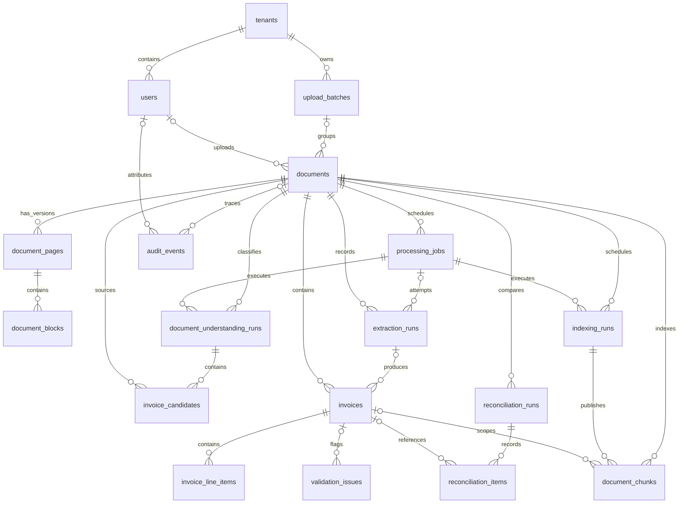

# Initial PostgreSQL schema

The schema contains twenty-one business tables: the original fifteen, two understanding tables added in migration 0006, two extraction tables added in 0007, financial_validation_runs added in 0008 and indexing_runs added in 0009. Twelve versioned migrations are applied. The migration tool also owns pgmigrations. PostgreSQL owns durable records and history, including ingestion, extraction and indexing outbox intent. Redis transports jobs; it is not their permanent database.

## Tables and relationships

| Table | Stored information and constraints |
| --- | --- |
| `tenants` | Workspace identity, unique slug, lifecycle state, settings, timestamps. Provisioned by an administrator. |
| `users` | Tenant-scoped identity, email, optional external auth subject, role, active flag. Email uniqueness is case-insensitive within a tenant. No passwords are stored. |
| `upload_batches` | Uploader, batch label/status, expected file count, metadata, timestamps, tenant-scoped idempotency key/fingerprint, fenced staging lease. |
| `documents` | Tenant, batch/uploader, original filename/MIME/size/SHA-256/object key, document type, page count, processing state, explicit cloud-approval fields, metadata, timestamps. Source metadata is immutable. |
| `document_pages` | Logical page/frame/worksheet number and source version, extracted text/method, OCR confidence, dimensions/coordinate system, worksheet/cell range, source reference, optional extraction run. Append-only evidence. |
| `document_blocks` | Ordered page blocks, text/table/cell types, OCR method/confidence, finite bounding box, coordinate system, structured table data, worksheet/cell references. Append-only evidence. |
| `invoices` | Nullable number/date/supplier/customer/amounts/currency, source document/page/block and extraction run, segmentation ordinal, extraction metadata, field evidence, immutable original values, current review state and revision. |
| `invoice_line_items` | Invoice/document/page/block references, order, nullable description/quantity/unit price/tax rate/line total, source evidence, immutable original values and revision. |
| `extraction_runs` | Document/job references, provider/model/prompt/schema versions, source and cloud-approval snapshots, structured result, response/error metadata, timing/status. Finalized runs are immutable. |
| `validation_issues` | Stable issue code, severity, affected field/entity, expected/actual JSON, original/related document and invoice references, evidence, resolution state/actor/time/note. |
| `reconciliation_runs` | Explicit left/right document pair, PDF/PDF or PDF/spreadsheet type, requester, configuration, status, summary, timing/errors. |
| `reconciliation_items` | Matching status, issue/severity/field, expected/actual JSON, left/right invoice/block evidence, resolution metadata. The document pair must match its run. |
| `document_chunks` | Tenant/document and optional invoice/page/block references, text/source version, source JSON, nullable 1024-dimensional embedding, model ID/version/configuration/time, generated full-text search vector. |
| `processing_jobs` | Document/parent references, job and pipeline versions, tenant-scoped idempotency key, queue references, durable state/attempts, progress/checkpoint/errors, compact immutable ingestion payload, dispatch state/failure count and fenced dispatch/execution leases. |
| `audit_events` | Tenant, actor/document/entity, operation/correction/resolution/review type, reason, before/after JSON, transaction ID and timestamp. Application callers cannot forge or mutate these rows. |
| `document_understanding_runs` | Tenant/document/job, normalized source version/manifest, algorithm version, classification/confidence, review flag, counts and AI status/warnings. Append-only. |
| `invoice_candidates` | Run/document/tenant, stable candidate UUID/ordinal, classification/confidence, review flag and canonical JSON with source locations/evidence/advice. No uniqueness by invoice identifier. Append-only. |
| `extraction_attempts` | Document/run/provider/model/prompt identity, bounded attempt ordinal, policy/input-hash snapshot, fallback flag, schema result, usage, duration, error and completion metadata. Identity and finalized rows are immutable. |
| `llm_provider_health` | Tenant/provider/model/endpoint fingerprint, protocol success/failure counts, consecutive failures, last error/timestamps and circuit-open deadline. No credentials or raw endpoint URLs. |
| `financial_validation_runs` | Immutable invoice/document/tenant identity, requester/idempotency key, engine/rules/hash, exact current/original input and duplicate snapshots, financial status and structured checks/issues. Forced RLS and source/status consistency constraints. |
| `indexing_runs` | Tenant/document/job, requester/key, source version/generation, embedding space/configuration, status, chunk/cache counts, timing/error. Finalized runs and identity are immutable; forced RLS and composite foreign keys apply. |



All business tables are tenant-scoped. Child relationships use composite foreign keys containing `tenant_id`; a valid foreign UUID alone is insufficient. Page/block anchors additionally include `document_id`, and combined page/block references must identify the same page. Deletes default to restriction rather than cascading away evidence or history.

Migration 0007 links extraction jobs/runs/invoices to immutable invoice candidates and understanding versions. A trigger binds compact extraction payloads to the correct candidate/run, queue and job identity. A partial unique index permits one AI invoice per extraction snapshot; it does not prohibit duplicate invoice numbers, repeated candidate extractions or legitimate duplicate documents. Document data_classification defaults to confidential. Only active same-tenant administrators with an explicit reason can change classification/cloud approval; PostgreSQL sets actor/time stamps and audits the decision. AI document_type remains independent of this privacy classification.

Migration 0008 adds audited invoice financial_terms, immutable financial_validation_runs, validation issue run/severity/review links, and deterministic reconciliation snapshot/status/key/hash fields. Reconciliation processing status remains separate from financial_status. Finalized deterministic runs and calculated issue/comparison fields are immutable; resolution status/notes retain the existing actor/reason/audit workflow. Unique keys enforce request idempotency, never invoice-number uniqueness. Numeric original/current values are selected as strings in financial APIs. Financial status is derived from the latest snapshot only when its input, duplicate context and engine still match; later changes leave the old result intact and require revalidation.

## Data conventions

- IDs are database-generated UUIDs; timestamps use `timestamptz`.
- Missing invoice fields remain SQL `NULL`. Metadata/evidence maps default to empty objects; they do not imply extracted confidence or fabricated values.
- Financial amounts and quantities use `finite_decimal`, a `NUMERIC(24,8)` domain excluding NaN. Signed values support credit records. There are no subtotal/tax/total arithmetic rules in this phase.
- PostgreSQL/pg returns financial columns as decimal strings. JSONB retains exact numeric values in PostgreSQL; JavaScript JSON parsing can round large numeric tokens. Select exact history values using `->>` or explicit numeric `::text` when serializing financial history; never route them through `Number`.
- Tax rates are normalized fractions in `[0,1]`; OCR confidence is normalized to `[0,1]`. Unknown rates/confidence remain null. Raw source representations belong in evidence JSON.
- Bounding boxes are `[x0,y0,x1,y1]`, finite and ordered, with an explicit coordinate system. PDF points, image pixels, normalized coordinates, and worksheet references are distinguished.
- A worksheet is a logical `document_pages` row with its name and workbook ordinal. CSV and multi-frame images have explicit source kinds. `source_version` permits another extraction without replacing referenced evidence.
- Table data and source metadata are JSONB. Source references can preserve cell/range addresses, formula text/cached values, quotes, and additional parsing details. Detailed extraction contracts are a later phase.
- Document hashes and invoice identifiers are indexed **without unique constraints**. Duplicate records remain representable and can be linked through validation issues.
- `segment_number` is not unique: a repeated extraction/duplicate invoice must not be rejected because it shares a source segment.
- Tenant users are modeled as one row per tenant identity. Cross-tenant membership and authentication flows are not implemented here.

## Runtime access and transactions

The login `document_intelligence_app` is neither a table owner nor a superuser and has no BYPASSRLS, role creation, database creation, replication, or inherited role privileges. It cannot switch into the migration owner. Every business table has `ENABLE ROW LEVEL SECURITY` and `FORCE ROW LEVEL SECURITY`.

An absent tenant setting yields no visible tenant rows and rejects writes. PostgreSQL superusers bypass row-level security, which is why runtime and migration credentials are separate. See [PostgreSQL row-security documentation](https://www.postgresql.org/docs/17/ddl-rowsecurity.html).

Use the exported helper for all tenant business queries:

```typescript
import { withTenantTransaction } from '@doc/database';

const result = await withTenantTransaction(pool, {
  tenantId: trustedTenantId,
  actorUserId: trustedUserId,
  reason: 'Correct total using reviewed page evidence',
}, (client) => client.query(
  'UPDATE invoices SET total = $1 WHERE id = $2 AND revision = $3 RETURNING id, revision',
  [decimalString, invoiceId, expectedRevision],
));

if (result.rowCount !== 1) {
  // Treat a stale revision or inaccessible record as a conflict/not-found outcome.
}
```

Tenant, actor, and reason are validated. The helper uses `SET LOCAL ROLE` and parameterized transaction-local settings, validates an active tenant/actor, commits or rolls back, and releases the client. Context does not leak to another pooled request. `withTransaction` also supports read committed, repeatable read, and serializable isolation. Serializable conflicts require caller-level retry handling; no retry loop is hidden inside a transaction callback.

Tenant identity must come from trusted authentication/worker context. These settings do not authenticate an end user: anyone possessing the runtime database credential is a trusted server principal and can select a tenant context. Do not expose the credential to browsers or accept tenant/actor IDs directly from an untrusted request without authorization.

Runtime clients can select tenant data and insert business records. They cannot create tenant/users, mutate source page/block evidence, delete business/audit records, truncate tables, alter schema, or write migration history. Administrative provisioning/retention belongs to separate commands and deployment credentials.

The additional `document_intelligence_dispatcher` login cannot select or mutate business tables directly. It may execute only the bounded, fixed-search-path outbox claim/ack functions introduced in `0005`. These functions use row locks, lease tokens and safe tenant audit context to dispatch across tenants without giving the worker migration-owner credentials. Ingestion payloads are limited to 4 KiB and bound to the document's tenant, storage identity, size and SHA-256. See the [ingestion reference](ingestion.md) for publication recovery, retries and storage reservations.

## Corrections, review, and audit

Invoice and line-item insert triggers capture original values independently of a caller-supplied snapshot. Those snapshots cannot be replaced. Updates to extracted fields require an active same-tenant actor and a nonempty reason; the revision increments automatically. Invoice edits move review state to `needs_review`, requiring a separate explicit approval/rejection decision. This records human review; it does not calculate or approve financial arithmetic.

Validation/reconciliation resolutions likewise require actor/reason context. Resolution author/time are set by the database, and a missing note is filled from the change reason. Before/after values are recorded in `audit_events` in the same transaction as the edited record. Rolled-back corrections do not leave orphan history.

The privileged audit trigger checks tenant and actor, uses a fixed search path and qualified relation names, and cannot be invoked directly by the runtime role. Audit history is append-only, including protection against owner-level UPDATE/DELETE/TRUNCATE while its triggers remain installed. A trusted database administrator can still alter/disable schema protections; this is not an external tamper-proof ledger.

Large immutable source text, tables, extraction results, and vectors remain on their source rows rather than being copied into every audit event. Events retain entity/source references and small metadata. Financial correction events retain full before/after record values and immutable original snapshots.

## Search and embeddings

`document_chunks.embedding` is `vector(1024)`, indexed using HNSW and `vector_cosine_ops` (`m=16`, `ef_construction=64`). A partial index excludes null embeddings. Zero vectors, wrong dimensions, and embeddings without model identity/version/time are rejected. Unembedded chunks are valid and have null model identity/version/time.

The model configuration JSON records adapter, model ID/revision, dimensions, query instruction, context limit, chunk/source-builder versions, target/maximum chunk sizes and the SHA-256 space identity. A content SHA-256 supports same-tenant/same-space vector reuse. Equal dimensions do not make distinct embedding spaces interchangeable. Tenant row security applies to vector queries.

```sql
SELECT ch.id, ch.chunk_text, ch.embedding <=> $1::vector AS distance
FROM document_chunks ch
JOIN documents d ON (d.tenant_id,d.id)=(ch.tenant_id,ch.document_id)
JOIN indexing_runs r ON (r.tenant_id,r.id)=(ch.tenant_id,ch.indexing_run_id)
WHERE ch.tenant_id=$2 AND ch.embedding IS NOT NULL
  AND ch.embedding_model_id=$3 AND ch.embedding_model_version=$4
  AND r.space_id=$5 AND ch.embedding_configuration->>'space_id'=$5
  AND r.status='succeeded' AND r.source_generation=d.search_generation
  AND d.metadata#>>'{search,runId}'=r.id::text
ORDER BY ch.embedding <=> $1::vector
LIMIT $6;
```

Execute this within the tenant transaction; the repository additionally filters document processing state, rejected invoices and requested invoice/supplier/date criteria. It enables `hnsw.iterative_scan='strict_order'` for semantic queries. For filtered ANN queries at scale, benchmark recall and tune iterative scan settings or partitioning; an approximate index is not a recall guarantee. See [pgvector filtering guidance](https://github.com/pgvector/pgvector#filtering). A generated `simple` full-text search vector and GIN index support keyword queries. Hybrid search uses RRF with k=60. Exact invoice SQL reads current invoice records independently of embedding availability.

Migration 0009 adds `documents.search_generation`. Changes to active processing/understanding metadata or invoice/line records increment it. Index requests lock the document and atomically insert an indexing run and compact durable job. Publication locks/fences the source generation before setting `documents.metadata.search` and completing run/job in one transaction. Failed or partial runs never become searchable; source edits immediately hide stale heads. Reindexing preserves historical vectors and uses new run-scoped chunk identity, while legacy chunks retain their original uniqueness rules. New indexed chunks are immutable and must match their run's tenant/document/model/version/space and normalized vector constraints.

Migrations 0010 and 0011 bind index payloads to durable run/document/job/queue identities and protect completed work against lost publish acknowledgements. The deferred guard has a fixed search path and SECURITY DEFINER for its explicit tenant/ID lookup: deferred triggers fire after a dispatcher function has restored the restricted caller role. PUBLIC execution is revoked; the dispatcher still cannot read business tables. Its only new capabilities are bounded leased index claim/ack functions.

Both real model candidates were run against a labeled synthetic English/Bengali benchmark. Integration schema/vector tests still use explicitly synthetic vectors, while separate live HTTP checks exercise real local Qwen inference. See the [phase 8 report](phase-8-local-search.md) and [measured comparison](evaluation/embeddings-comparison.json).

## Source processing snapshots

Phase 4 uses the existing pages/blocks schema without another migration. PDF pages/image frames and worksheet/CSV headers become document_pages. Streamed cell batches append document_blocks with cell coordinates, formula text/cached values and artifact/line references. A processing retry appends a new source_version; it cannot overwrite immutable evidence. The successful processing checkpoint in documents.metadata.processing and processing_jobs.checkpoint identifies the active sourceVersion/runId/manifestKey. Partial failed-attempt snapshots remain traceable and must not be mixed into the active result. Source extraction runs are not represented as AI extraction_runs.

## Migration workflow and rollback

Migrations use pinned `node-pg-migrate` 9.0.0 with SQL files, ordered history in `public.pgmigrations`, PostgreSQL advisory locking, a five-second lock timeout, and an explicit shared transaction. A failure rolls back the attempted migration batch and its history entries. Files use the tool's Up/Down SQL sections. See [node-pg-migrate SQL/programmatic usage](https://salsita.github.io/node-pg-migrate/api).

| Version | Up | Down |
| --- | --- | --- |
| `0001` | Enable pgvector idempotently | Preserve the potentially pre-existing/shared extension |
| `0002` | Create domains, helpers, and all fifteen tables | Drop application tables/domain/helper in dependency order |
| `0003` | Apply tenant policies, runtime grants, provenance/review/audit triggers | Remove these grants/policies/triggers; application access fails closed |
| `0004` | Create foreign-key, filtering, review, keyword, and HNSW indexes | Drop these indexes |
| `0005` | Add upload reservations/idempotency, ingestion states, durable payloads, fenced outbox/execution leases, restricted dispatcher functions and dispatch index | Remove ingestion-specific additions; map `ingested` to `uploaded` and `uploading` to `failed` while preserving business records and stored originals |
| `0006` | Add append-only understanding runs/candidates, composite tenant/document FKs, forced RLS, identity constraints, audit triggers and result/review indexes | Remove active understanding pointers and restore generic file-kind typing; drop candidate/run tables. Preserve source evidence, originals and audit history |
| `0007` | Add administrator-controlled cloud classification, candidate-bound extraction dispatch, immutable provider attempts, tenant health/circuits, extraction metadata and indexes | Cancel unfinished extraction jobs/runs, restore ingestion-only dispatch functions, drop new links/policy/attempt/health state. Preserve invoice snapshots, structured extraction results, source evidence and audit events |
| `0008` | Add audited financial terms, immutable financial validation snapshots, financial issue links/severity, reconciliation financial snapshots/status/idempotency, result guards and duplicate/version indexes | Remove the new financial validation table, terms and links; preserve invoices/original snapshots, existing issue/reconciliation values and audit history. Export the new snapshots first |
| `0009` | Add source generations, tenant-scoped indexing runs, immutable run-linked chunks, cache/run indexes and leased index outbox functions | Cancel unfinished index jobs, remove active heads/run links, remap historical chunk source versions to preserve every vector while restoring legacy uniqueness; drop indexing metadata/functions |
| `0010` | Strengthen model configuration identity, bind deferred job payloads, preserve terminal jobs when a publish acknowledgement is lost | Remove the payload guard and restore the 0009 acknowledgement/configuration rules |
| `0011` | Give the fixed-path deferred index guard owner privileges for its explicit tenant/job/run lookup | Restore invoker privileges; downgrade only with writers stopped because the old dispatcher path cannot run this deferred check |
| `0012` | Add transactional workflow triggers, a pending-work index and a restricted leased claim function over existing processing_jobs | Remove triggers/function/index, cancel unfinished workflow jobs with tenant audit context; preserve completed jobs, corrections, invoices and audit history |

```bash
npm run db:setup
npm run db:status
npm run db:migrate
npm run db:seed
npm run db:rollback -- --version 0012 --dry-run
```

`db:setup` is a development convenience: add missing configuration, provision the restricted application and dispatcher logins, migrate, and seed. `db:migrate` provisions the same roles and applies pending SQL without fixtures. Repeating either does not duplicate migrations. Repeating seeds does not replace user edits or create extra audit events. Seeding is refused outside development/test.

After reviewing the current version and its Down SQL, omit `--dry-run` to revert **one** latest migration. A mismatched or missing version is rejected. Subsequent reversions must name the new head. Rollback of `0002` deletes application data and requires a backup; applying its Up SQL again recreates empty tables, not deleted records. Prefer forward fixes and tested backup restoration once real documents exist. No `CASCADE` is used to silently remove unknown dependent objects.

Runtime login provisioning is a cluster-level operation outside migration rollback. Down migrations do not delete the login, shared database, named Docker volumes, or vector extension. Do not edit published/applied migration files; append a new version. The tool checks migration order/names, not file-content cryptographic checksums.

Stop API/worker writes before downgrading `0005`. Its Down migration removes idempotency/outbox fields and functions; retained private objects are not deleted, and reapplying Up does not reconstruct dispatch intent. Back up the database and storage inventory first. The full down/up path is tested only in a disposable database.

Stop writers and export financial_validation_runs, financial_terms and reconciliation snapshots before downgrading 0008. Its Down migration removes those additions without deleting invoices, original_values, issue values, existing reconciliation results or audit events. Reapplying initializes financial_terms to unknown/empty and does not reconstruct validation runs; no result is marked current merely because an old audit record remains. Tests verify these guarantees in a disposable database.

Stop writers and export extraction attempt/health/privacy metadata before downgrading 0007. Its Down migration cancels unfinished extraction jobs/runs; invoice values, structured results and audit history remain. Reapplying Up does not restore removed candidate links, consent classifications or attempt records. Newly added privacy classifications reset to confidential. Tests exercise this cancellation and source preservation in a disposable database.

Stop writers and export indexing_runs/configuration/history before downgrading 0009 (first revert 0011 and 0010). Its Down SQL preserves text, source references and vectors, gives each former run a noncolliding legacy source_version and records the original version under source_reference.rollback_original_source_version. It cancels unfinished index jobs and removes heads/run links. Reapplying Up does not reconstruct index runs or republish retained vectors; explicitly reindex. Search integration tests verify preservation and safe reapplication in a disposable database.

Likewise stop writers and back up before downgrading 0006: candidate snapshots are deleted, active pointers are removed with tenant audit context, and document typing falls back to spreadsheet/unknown from original inspection. Reapplying Up does not recreate classifications or restore candidate data. Source pages/blocks, private files and audit events remain. Tests cover this downgrade and the full twelve-migration down/up path in disposable databases. No understanding or AI outputs are seeded as though execution occurred.

The migration tool's transitive `glob` dependency is narrowly overridden to patched 14.0.6; the SQL loader and advisory/rollback behavior are covered by database tests. This avoids the audit findings from its original glob/minimatch dependency resolution without a forced migration-tool downgrade.

## Development data and tests

The seed creates two fictional tenants and reviewers, a PDF/spreadsheet comparison, duplicate invoice records, one line item, source/worksheet evidence, pending job/extraction metadata, issue/reconciliation fixtures, one unembedded chunk, and real database audit events. One explicitly labeled fixture correction demonstrates original/current/history separation. No corresponding S3 objects are uploaded and no processing, duplicate detector, financial validator, reconciler, or model is executed.

```bash
npm run test:database
npm run test:financial
npm run test:search
```

Tests create a unique `di_schema_test_*` database from `template0`, apply the SQL, use the restricted login for tenant queries, and remove only that test database afterward. They need the configured local migration owner's CREATEDB/CREATEROLE privileges. Rollback and intentional-failure tests operate in that disposable database, never the development database. Credentials are neither printed nor stored in fixtures.
