# Document ingestion

This reference describes the ingestion foundation from phase 3. Phase 4 adds local document processing after byte verification: new uploads now reach processed/partially_processed/failed and retain versioned evidence/artifacts. See the [document-processing report](phase-4-document-processing.md) for current engine behavior and internal APIs. Invoice extraction, financial validation, embeddings and reconciliation remain unimplemented.

## Local setup and access

```bash
npm ci
npm run setup:env
uv pip install --python "/Users/sakibsmacbookm5/Documents/Python work/.venv/bin/python" -r services/document-processor/requirements-test.txt
npm run infra:up
npm run db:setup
npm run dev
```

Use the existing Python interpreter; no environment creation or synchronization is needed. Setup adds missing root configuration without replacing existing values. New credentials are random and stored only in ignored `.env` with mode 0600.

Document APIs open directly in the server-configured local workspace. Set `LOCAL_WORKSPACE_TENANT_ID` and `LOCAL_WORKSPACE_USER_ID` to existing active records; defaults select the seeded tenant A reviewer. There is no sign-in, access-token issuance or session cookie. All visitors share this operator and audit identity. Reader operators can read metadata; writes require reviewer/admin. Client headers and multipart fields cannot override the workspace. PostgreSQL row security remains active. An unavailable configured tenant/operator returns 503. See [local workspace](local-workspace.md).

## REST contract

| Method/path | Result |
| --- | --- |
| `POST /v1/upload-batches` | Multipart repeated `files` fields; optional `Idempotency-Key`; HTTP 202 with batch/documents |
| `GET /v1/upload-batches/:id` | Tenant-scoped batch state and documents |
| `GET /v1/documents` | Keyset pagination; `limit` 1–100, optional `status`, `batchId`, `cursor` |
| `GET /v1/documents/:id` | Document DTO and format inspection metadata |
| `GET /v1/documents/:id/status` | Authoritative document/job state, attempts, dispatch failures and safe error codes |
| `GET /v1/documents/:id/understanding` | Active classification and paginated invoice/receipt/business/unknown candidates with evidence and manual-review flags; see [phase 5](phase-5-understanding.md) |

Foreign-tenant or missing documents/batches return 404. Unavailable configured workspace/operator returns 503. Parameters, queries and responses use Zod validation. List pagination includes the exact database timestamp plus UUID to avoid skipping rows with sub-millisecond creation times.

Example:

```bash

curl -i http://127.0.0.1:3001/v1/upload-batches \
  -H "Idempotency-Key: invoices-2026-batch-001" \
  -F "files=@/absolute/path/invoice.pdf;type=application/pdf" \
  -F "files=@/absolute/path/ledger.xlsx;type=application/vnd.openxmlformats-officedocument.spreadsheetml.sheet"
```

Successful shape, with generated IDs omitted here:

```json
{
  "batchId": "BATCH_UUID",
  "status": "accepted",
  "idempotencyKey": "invoices-2026-batch-001",
  "replayed": false,
  "documents": [
    {
      "id": "DOCUMENT_UUID",
      "uploadBatchId": "BATCH_UUID",
      "originalFilename": "invoice.pdf",
      "mimeType": "application/pdf",
      "fileSizeBytes": 1234,
      "sha256": "64-character SHA-256",
      "documentType": "unknown",
      "pageCount": 2,
      "processingStatus": "uploaded",
      "duplicateOfDocumentId": null,
      "antivirus": { "status": "not_scanned", "engine": null, "scannedAt": null },
      "createdAt": "ISO-8601 timestamp"
    }
  ]
}
```

This JSON is a shape example, not an execution/evaluation result. Responses never include entire files, extracted text, private storage credentials, or public download URLs. Unknown document type stays `unknown`; no invoice classification is inferred in this phase.

## File checks and limits

Supported extensions: `.pdf`, `.jpg`, `.jpeg`, `.png`, `.tif`, `.tiff`, `.xlsx`, `.xls`, `.csv`, case-insensitive.

- Filenames cannot contain path separators, encoded separators, control/bidi override characters, or more than 255 UTF-8 bytes. Filesystem paths and S3 keys are generated from UUIDs, not filenames.
- Declared MIME must agree with the extension or be generic `application/octet-stream`. CSV also accepts `text/plain` and `application/csv`. The canonical MIME is set only after content inspection.
- PDF headers/trailers and PyMuPDF structure/page count are inspected. Password-protected files are rejected. Recoverable parser repairs are surfaced as `PDF_REPAIRED`; no text or images are extracted.
- JPEG/PNG/TIFF signatures and Pillow format/decoding are checked. Multi-frame TIFF/image counts, per-frame and total pixels are bounded.
- XLSX must be a valid OOXML workbook ZIP with correct content types, relationships and worksheet parts. Entry paths, duplicate entries, encryption, macro project names, CRCs, XML entities, inflated sizes and compression ratios are checked. Archive entries are never extracted to filesystem paths and external relationships are never followed.
- XLS requires an OLE signature and an actual xlrd-readable workbook. Worksheet names/counts are inspected without evaluating macros or formulas.
- CSV has no binary signature. It is decoded as UTF-8/BOM or BOM-marked UTF-16, checked for binary controls/obvious markup, and parsed using strict CSV syntax with consistent row width. Single-column CSV is supported. It counts as one logical source page.

| Root configuration | Default |
| --- | --- |
| `UPLOAD_MAX_FILES` | 10 files per request |
| `UPLOAD_MAX_FILE_BYTES` | 52,428,800 (50 MiB) |
| `UPLOAD_MAX_BATCH_BYTES` | 104,857,600 (100 MiB of file data) |
| `UPLOAD_MAX_PAGES` | 1,000 PDF pages/image frames/worksheets per document |
| `UPLOAD_MAX_CONCURRENT` | 4 upload handlers per API process |
| `UPLOAD_LEASE_SECONDS` | 900 seconds for staging reservation recovery |
| `INSPECTION_TIMEOUT_MS` | 30,000 per inspection |
| `S3_OPERATION_TIMEOUT_MS` | 30,000 per storage operation |

Multipart also limits field/part/header counts, rejects non-file fields, counts aggregate file bytes, and caps raw request bytes including a bounded header allowance. A streaming guard observes the multipart parser's raw input without starting a competing pipe. Client disconnection/validation failures clean temporary staging paths. Temporary directories are private; staged files use mode 0600 and random names.

The Python service authenticates internal requests before multipart parsing, bounds request bytes, admits at most two inspection tasks simultaneously, and performs parser work in disposable processes with a hard timeout. Those processes use the exact existing interpreter. Additional defenses currently cap images at 40 million pixels/frame and 200 million pixels/document; ZIP entries at 10,000, total inflation at 128 MiB, and per-entry compression ratio at 200. CSV parsing caps rows/columns. These defensive format caps are currently code-level limits.

No uploaded executable, embedded macro, formula, shell command, PDF JavaScript, external workbook target, or document-specified URL is executed. No source content is sent to an LLM or cloud extraction provider.

## Atomic batches, idempotency and duplicates

All files must pass validation/scanning before a batch is reserved or storage is written. Any invalid file rejects the request. This is not a partial-acceptance API.

`Idempotency-Key` accepts 8–128 ASCII letters/digits/periods/underscores/hyphens. If omitted, the server generates a UUID and returns it. Intentional client retries should supply their own key. Identity is scoped to tenant and original uploader; the fingerprint covers ordered filenames, canonical types, byte sizes and hashes.

- Same key and same payload after acceptance returns the same batch/document IDs with `replayed: true` and no new objects/jobs.
- Changed payload or another uploader's key returns 409 `IDEMPOTENCY_CONFLICT`.
- An active reservation returns 409 `UPLOAD_IN_PROGRESS` and `Retry-After`; retry with the same key.
- An expired/failed reservation can resume with its original document IDs/object keys.
- Same bytes under another intended upload remain separate records. `duplicateOfDocumentId` is a same-tenant content-hash hint, not an invoice duplicate determination.

Original keys are `tenants/TENANT_UUID/documents/DOCUMENT_UUID/source.EXT`. MinIO writes use the AWS S3 SDK, canonical content type, attachment disposition, known byte length, SHA-256 checksum, and tenant/document/hash metadata. The private bucket has no anonymous-access policy; integration tests verify anonymous reads return 403.

PostgreSQL first records a leased batch/document staging plan, then files are stored, then a database transaction marks documents uploaded and creates durable jobs. Jobs are never dispatched before that final transaction commits. If storage fails or the process crashes, private partial objects remain owned by persisted failed/staging document records. A same-key retry safely rewrites the same bytes/keys. Automatic retention/garbage collection for abandoned failed uploads is not implemented; administrative cleanup must honor those records and leases.

## Durable dispatch and execution

```mermaid
flowchart LR
  Client[Authenticated multipart upload] --> Validate[Stream hash and validate]
  Validate --> Inspect[Local signature and page inspection]
  Inspect --> Reserve[PostgreSQL staging reservation]
  Reserve --> S3[Private MinIO original]
  S3 --> Commit[Transaction: uploaded documents and pending jobs]
  Commit --> Outbox[Leased outbox publisher]
  Outbox --> Redis[BullMQ document-queue]
  Redis --> Verify[Worker verifies stored bytes]
  Verify --> State[PostgreSQL ingested or failed state]
```



All required queues are registered: `document-queue`, `ocr-queue`, `extraction-queue`, `validation-queue`, `indexing-queue`. Only `document-queue` has an ingestion consumer in this phase. The independent `foundation-health` queue remains for operational checks. No fake OCR/extraction/validation/indexing jobs are completed.

`processing_jobs` serves as the transactional outbox. Job UUIDs are stable BullMQ IDs; payloads contain schema version, tenant/document/job IDs, bucket/key/hash/size/type references. JSON contracts and a 4 KiB storage constraint prevent large file/text payloads. Storage references are bound to the authoritative document row and ingestion identity/payload is immutable.

The separate `document_intelligence_dispatcher` login has no business-table read/write permissions. It may call only bounded claim/ack functions that expose leased dispatch references. Functions use fixed search paths, row locks, `SKIP LOCKED`, claim tokens, safe system audit context and no client-supplied SQL. Worker document queries still use the regular tenant-scoped runtime role. Migration credentials are not used for runtime dispatch.

Dispatch acknowledges only after BullMQ accepts the job. A crash between publication and acknowledgment is safe: an expired claim is retried with the same ID. Published, unfinished database jobs are periodically checked; missing Redis jobs are recreated, and stale completed/failed transport records can be replaced while respecting PostgreSQL attempt state.

Defaults:

- Outbox polling every 1 second; dispatch leases last 30 seconds.
- Dispatch failure backoff starts at `INGESTION_BACKOFF_MS` (1 second), doubles, and caps at 60 seconds. Ten consecutive failures mark dispatch `dead`, job/document `failed`, retaining metadata/history.
- Published unfinished jobs are rechecked every 30 seconds (`OUTBOX_RECHECK_SECONDS`).
- Actual processing allows three database-counted attempts and BullMQ exponential backoff. A crashed execution can be reclaimed after its 180-second lease; token fencing prevents stale completions from overwriting another claim.
- Stored-byte verification checks length, canonical MIME, tenant/document/hash metadata, and recomputed SHA-256. Same-size tampering is detected. Permanent integrity failures fail immediately; transient storage failures retry within the limit.
- Failed BullMQ transport jobs are retained within bounded count/age limits. PostgreSQL job/error/audit state persists independently of Redis retention or loss.

API acceptance depends on PostgreSQL, MinIO and the local inspector, not Redis. An upload can return 202 during a queue outage because its dispatch intent is committed. Worker readiness reports queue/processor unavailability. Historical `ingested` records mean originals passed ingestion checks. In phase 4, new jobs additionally process source text/cells/OCR and persist evidence before completion; terminal states and artifacts are described in the processing report. Reprocessing terminal failures through a new application endpoint is a later phase.

## Antivirus configuration

`AntivirusScanner` is an integration interface with disabled and ClamD INSTREAM implementations. Disabled mode returns `not_scanned`, never `clean`. ClamAV mode streams bytes using length-prefixed frames without invoking a shell or sending user-supplied filenames as commands. A hard deadline, response-size bound and protocol checks apply. FOUND yields 422 `MALWARE_DETECTED`; connection/timeout/protocol errors yield 503 `ANTIVIRUS_UNAVAILABLE` before storage.

To enable an existing private ClamD installation, set `ANTIVIRUS_MODE=clamav`, `CLAMAV_HOST`, `CLAMAV_PORT` (default 3310) and `CLAMAV_TIMEOUT_MS`. Keep definitions current and configure `StreamMaxLength`/scan limits to cover accepted upload sizes. ClamD TCP is not authenticated by the protocol, so keep it private; see [official ClamAV guidance](https://docs.clamav.net/manual/Usage/Scanning.html#clamd).

No daemon/signature database is downloaded or started automatically. Tests verify protocol framing and clean/FOUND/error behavior using a controlled loopback daemon, plus actual unavailable-service rejection through the API. They do not constitute real malware-detection evaluation.

## Errors and operational limits

Errors use `{ "error": { "code": "...", "message": "..." } }`. Typical outcomes are 400 invalid metadata/query/filename, 403 role denial, 404 inaccessible record, 409 idempotency/lease conflict, 413 configured limits, 415 extension/MIME/signature mismatch, 422 corrupt/encrypted/unsafe content or malware, 429 upload capacity, and 503 unavailable inspection/scanning/storage/workspace services.

CSV files with ragged rows or uncertain/unsupported encodings, encrypted PDFs/workbooks, raw non-OLE legacy XLS, oversized archives/images and macro-bearing XLSX containers are deliberately rejected. An antivirus policy change does not rescan already accepted idempotent replays. There is no public object download, public identity-provider integration or abandoned-upload retention job. Phase 4's local source/OCR processing is documented separately.

## Tests

```bash
npm test
npm run test:database
npm run test:ingestion
```

The ingestion suite creates a unique disposable PostgreSQL database, private bucket, Redis prefix, HTTP API and Python inspector, then cleans them up. It uses real format fixtures and the existing Python interpreter. Tests include actual HTTP 202/413 responses, every supported extension, fake content/MIME, duplicate preservation, idempotency/concurrency, tenant access, corruption/encryption, limits, unavailable antivirus, storage reservation recovery, Redis connection failure/recovery, publish/ack interruption, lost jobs, bounded failures and exact checksum tampering. No quality/evaluation results are fabricated.
